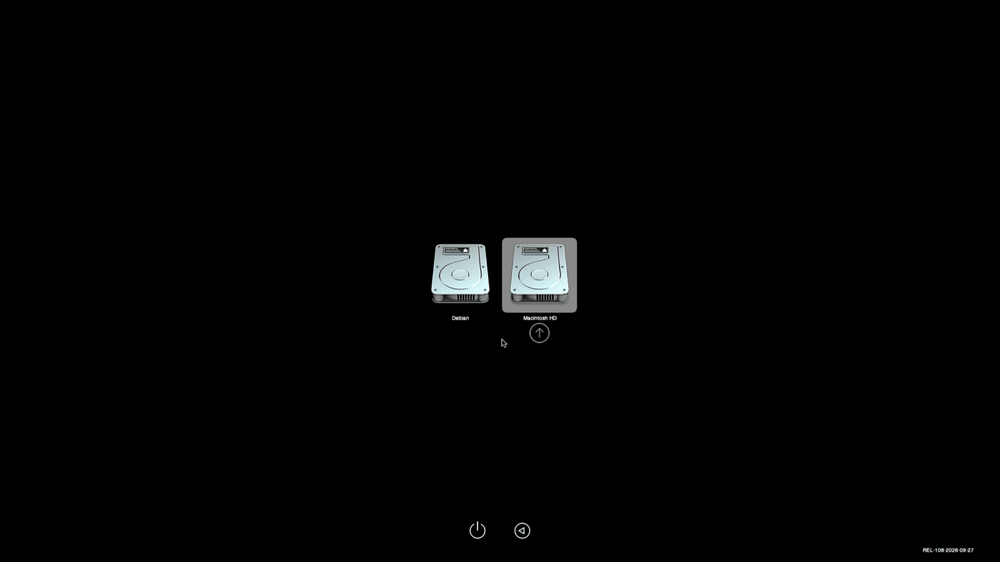

# Hackintosh: MSI H110M PRO-VD + i5-7400 (macOS 15 Sequoia)

[](docs/04-install.md)
[](https://github.com/acidanthera/OpenCorePkg/releases/tag/1.0.8)
[](docs/03-smbios.md)
[](#hardware)
[](docs/06-config-explained.md#intel-hd-630-pciroot0x0pci0x20x0)
[](#hardware)
[](docs/07-troubleshooting.md#sleep-machine-check-on-wake)
[](docs/05-post-install.md#wake-on-lan)
[](https://github.com/Schoji/WhateverGreen/releases/tag/v1.7.2-dpllfix)
[](LICENSE)

This repo contains a working OpenCore EFI and a step-by-step guide for running macOS 15 Sequoia on an **MSI H110M PRO-VD** with an **Intel Core i5-7400** and its **HD 630** iGPU. No graphics card is used.

Sleep and Wake-on-LAN work. On this platform, sleep only works thanks to a fix for WhateverGreen developed for this build (`-igfxdpllfix`).



## Hardware

| Part | Model |
|---|---|
| Motherboard | MSI H110M PRO-VD (MS-7996), BIOS `E7996IMS.2H0` (2018-06-16) |
| CPU | Intel Core i5-7400 (Kaby Lake, 4C/4T) |
| iGPU | Intel HD Graphics 630 (`8086:5912`) |
| RAM | 16 GB DDR4-2133 |
| Disk | 240 GB SATA SSD (Goodram CL100) |
| Network | Realtek RTL8111H (onboard) |
| Audio | Realtek ALC887 (onboard) + HDMI audio through the iGPU |
| Display | Board DVI-D port → DVI-to-HDMI adapter → monitor |

### Display

The board has VGA and DVI-D outputs:

- **VGA does not work** in macOS on Skylake and newer.
- **DVI-D works**, with the connectors patched as HDMI in the EFI.

A DVI-to-HDMI adapter or cable is fine.

## What works

| Feature | Status |
|---|---|
| iGPU acceleration (Metal 3, 1536 MB), hardware HEVC/H.264 | ✅ |
| Sleep (S3) and wake, also after a warm restart | ✅ with `-igfxdpllfix` |
| Wake-on-LAN from sleep and from shutdown | ✅ with the patched network driver |
| Ethernet 1 Gb/s | ✅ |
| HDMI audio | ✅ |
| Analog audio (ALC887) | ⚠️ driver and jacks detected, never listened to |
| USB (all 14 ports mapped) | ✅ |
| NVRAM, restart, shutdown | ✅ |
| CPU power management (XCPM), temperatures | ✅ |
| iCloud sign-in | ✅ |
| iMessage / FaceTime | not tested |
| Wake from USB keyboard | not tested with a real keyboard |
| Wi-Fi / Bluetooth | ❌ no compatible hardware in this PC |

## Versions

| Component | Version |
|---|---|
| macOS | 15.8.3 Sequoia |
| OpenCore | 1.0.8 RELEASE |
| SMBIOS | `iMac19,1` |
| Lilu | 1.7.2 |
| WhateverGreen | 1.7.2 + DPLL fix ([release](https://github.com/Schoji/WhateverGreen/releases/tag/v1.7.2-dpllfix)) |
| VirtualSMC + SMCProcessor + SMCSuperIO | 1.3.8 |
| AppleALC | 1.9.8 |
| RealtekRTL8111 | 2.5.0 + Wake-on-LAN patch (the bundle reports `2.5.0d4`, as does upstream v2.5.0) |
| RestrictEvents | 1.1.6 |

## Guide

1. [BIOS settings](docs/01-bios.md), with screenshots of every page
2. [USB installer](docs/02-usb-installer.md)
3. [Your own serial numbers (SMBIOS)](docs/03-smbios.md), required before installing
4. [Installation](docs/04-install.md)
5. [Post-install: EFI on the SSD, sleep, Wake-on-LAN, updates](docs/05-post-install.md)
6. [What is in the EFI and why](docs/06-config-explained.md)
7. [Troubleshooting and lessons learned](docs/07-troubleshooting.md)

**Quick version for people who have done this before:**

1. Set up the BIOS as on the [BIOS page](docs/01-bios.md).
2. Generate your own `SystemSerialNumber`, `MLB`, `SystemUUID` and `ROM`.
3. Set `ScanPolicy` to `0` on the USB stick, and press Space in the picker to see the recovery.
4. Boot the Sequoia recovery (`Mac-937A206F2EE63C01`), install, and copy the EFI to the SSD.

## Repo layout

```
EFI/                 OpenCore EFI, ready to copy (placeholder serials, see docs/03)
docs/                the guide
extras/              sleepkeeper and netkeeper daemons, network driver patch
images/              BIOS screenshots and the boot picker
```

## Before you use it

- The serial numbers in `config.plist` are **placeholders**. Generate your own, as in [docs/03](docs/03-smbios.md).
- This EFI was built for and tested on this exact board, CPU and USB layout. On different hardware, at least the USB map and the iGPU properties will need changes. The USB map only applies to SMBIOS `iMac19,1`; if you change the model, change `USBMap.kext` too.
- The reference machine was installed through a Linux virtual machine with the SSD passed through, because of a faulty GPU. The USB installer path in the guide uses the same EFI and recovery image, but has not been run end to end on this machine. See [docs/04](docs/04-install.md).

## Credits

- [Acidanthera](https://github.com/acidanthera): OpenCore, Lilu, WhateverGreen, VirtualSMC, AppleALC, RestrictEvents.
- [Mieze](https://github.com/Mieze/RTL8111_driver_for_OS_X): RealtekRTL8111.
- [Dortania](https://dortania.github.io/OpenCore-Install-Guide/): the OpenCore Install Guide this build follows.
- [corpnewt](https://github.com/corpnewt): ProperTree and GenSMBIOS.

Third-party files keep their own licenses. See [THIRD-PARTY.md](THIRD-PARTY.md).
