# 1. BIOS settings

The board uses MSI Click BIOS 5, version **`E7996IMS.2H0`** (2018-06-16). Other versions may name or place things a little differently.

- **Del** opens the BIOS. If it opens in EZ Mode, press **F7** for Advanced mode. On this board the top tabs are *System Status, Advanced, Overclocking, M-Flash, Security, Boot, Save & Exit*. On other MSI boards the same menus sit under *Settings* and *OC*.
- **F11** opens the one-time boot menu.
- In the BIOS, the arrow keys switch tabs, **Enter** opens a setting, **Esc** goes back, and **F10** saves and exits.

> **Swapping the CPU, clearing CMOS or replacing the battery resets these settings to defaults.** After a CPU swap on this machine, several settings came back as defaults: CFG Lock, the wake options, the power-loss behavior, XHCI Hand-off and the Windows OS mode. Come back to this page after any of those.

The screenshots below were taken on the reference machine on 2026-11-20, in exactly the state it runs macOS in.

## Summary

| Where | Setting | Recommended | Reference machine | |
|---|---|---|---|---|
| Advanced → PCI Subsystem Settings | Above 4G memory | Disabled | Disabled | |
| Advanced → Integrated Peripherals | SATA Mode | **AHCI** | AHCI | required |
| Advanced → Integrated Graphics Configuration | Initiate Graphic Adapter | **IGD** | IGD | required without a graphics card |
| | Integrated Graphics Share Memory (DVMT) | **128M** | 128M | 64M also worked, thanks to the framebuffer patches |
| Advanced → USB Configuration | XHCI Hand-off | **Enabled** | Disabled | see note 1 |
| | Legacy USB Support | Enabled | Enabled | |
| Advanced → Power Management Setup | EuP 2013 | **Disabled** | Disabled | needed for Wake-on-LAN and USB wake |
| | Restore after AC Power Loss | your choice | Power On | the PC starts when power returns |
| Advanced → Windows OS Configuration | Windows 8.1/10 WHQL Support | **Enabled** | Disabled | see note 2 |
| | MSI Fast Boot / Fast Boot | **Disabled** | Disabled | required: otherwise USB is not ready for OpenCore |
| Advanced → Wake Up Event Setup | Wake Up Event By | BIOS | BIOS | |
| | Resume By PCI-E Device | **Enabled** | Enabled | Wake-on-LAN |
| | Resume By USB Device | Enabled | Enabled | wake from a USB keyboard or mouse |
| | Resume By RTC Alarm, PS/2 | Disabled | Disabled | |
| Overclocking → CPU Features | Intel VT-D Tech | **Disabled** | Disabled | the config also sets `DisableIoMapper` |
| | CFG Lock | **Disabled** | Disabled | then the `AppleXcpmCfgLock` quirk is not needed (see [config](06-config-explained.md#quirks-that-differ-from-a-blank-config)) |
| | Intel C-State | Auto | Auto | see note 3 |
| | C1E Support | Disabled | Disabled | |
| | SW Guard Extensions (SGX) | Disabled or Software Controlled | Software Controlled | |
| Boot | Boot Option #1 | UEFI Hard Disk | UEFI Hard Disk | |
| Boot → UEFI Hard Disk Drive BBS Priorities | Boot Option #1 | `UEFI OS (P0: <macOS SSD>)` | `UEFI OS (P0: SSDPR-CL100…)` | that entry is OpenCore on the SSD |

**Note 1, XHCI Hand-off.** Dortania recommends `Enabled`. The CPU swap reset it to `Disabled` on the reference machine, and everything still works, because the config has the `ReleaseUsbOwnership` quirk, which does the hand-off from OpenCore. Set it to `Enabled` if you can.

**Note 2, Windows OS mode.**

- With `Windows 8.1/10 WHQL Support = Enabled` the board boots in pure UEFI mode (CSM off), and the **Secure Boot** submenu appears. Set **Secure Boot Support = Disabled** there. That is the clean setup, and the one Dortania recommends. It is also how this machine was installed.
- After the CPU swap the board fell back to `Disabled` / `Windows 7 Installation = Enabled`. The Boot tab then shows `LEGACY+UEFI`. macOS still boots fine this way, because OpenCore is started in UEFI mode, but pure UEFI is preferred.

**Note 3, C-States.** Disabling Intel C-State made the old wake crashes rarer, but did not fix them. With the DPLL fix in place, `Auto` is fine and saves power at idle.

**Boot order.** MSI ignores boot order changes made from the operating system (`efibootmgr -o`, `bless`) and boots disks in the order of the BBS priority list. So set the order here, in the BIOS.

## Screenshots

### System Status

The HDD that holds Debian on the reference machine was unplugged when this was taken, so only the SSD is listed.

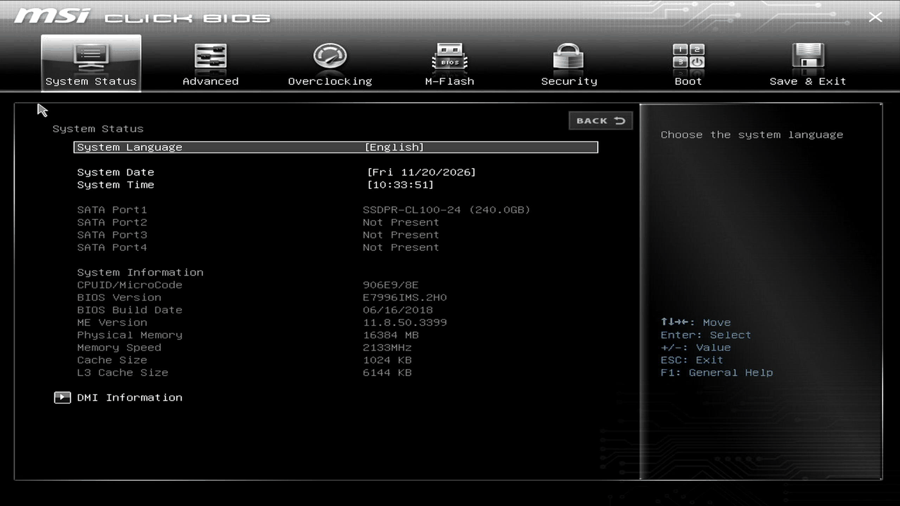

### Advanced

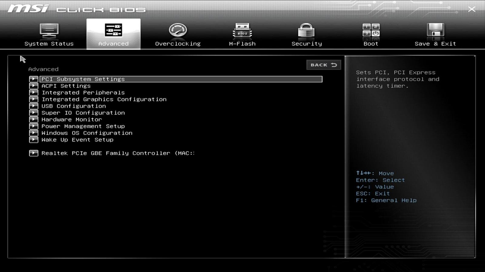

#### PCI Subsystem Settings

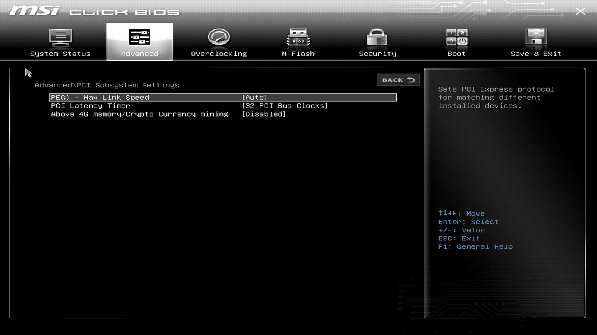

#### ACPI Settings

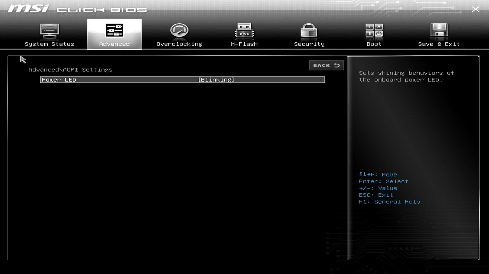

#### Integrated Peripherals: SATA in AHCI mode, HD Audio on

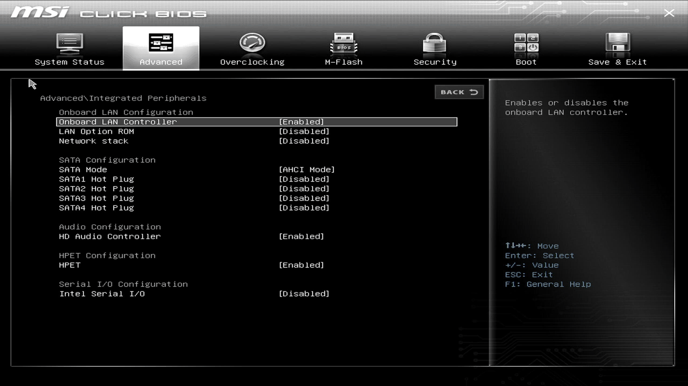

#### Integrated Graphics Configuration: IGD, 128M

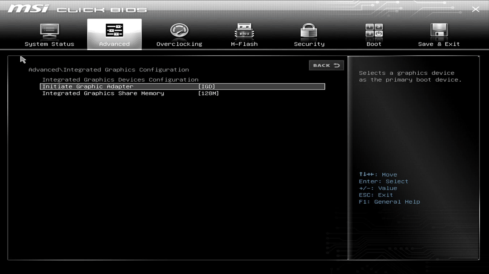

#### USB Configuration (XHCI Hand-off: see note 1)

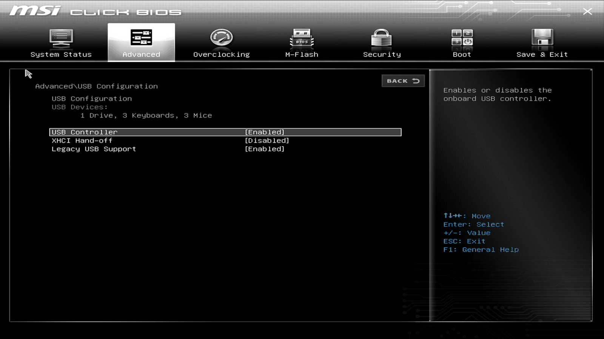

#### Super IO Configuration

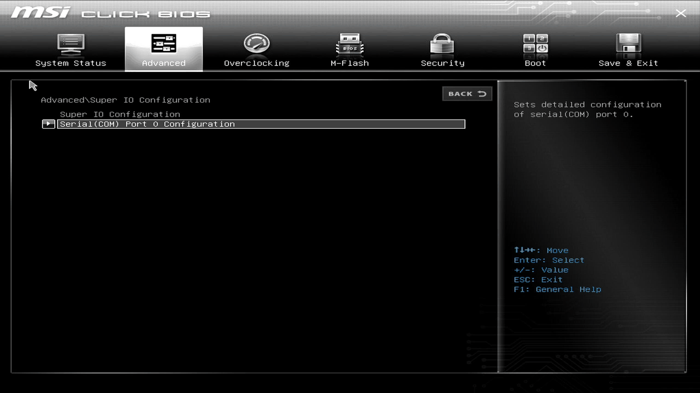

#### Hardware Monitor

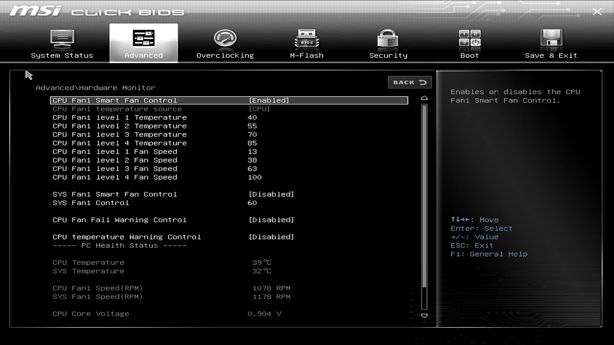

#### Power Management Setup

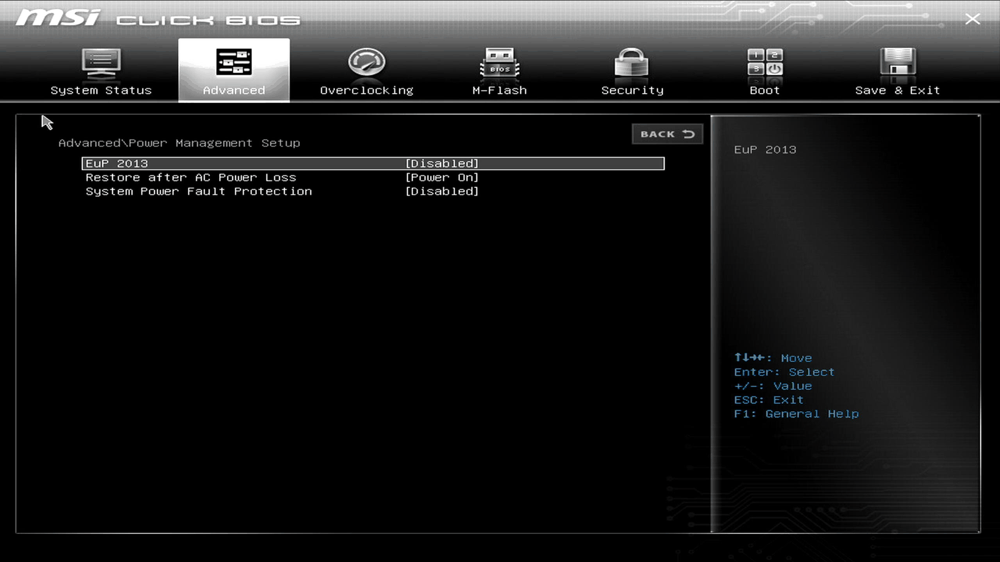

#### Windows OS Configuration (see note 2)

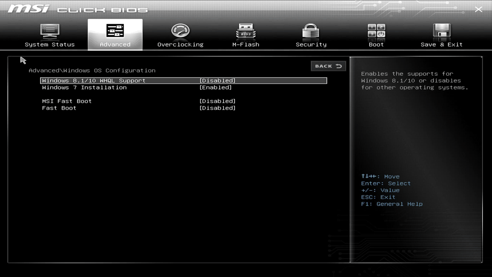

#### Wake Up Event Setup

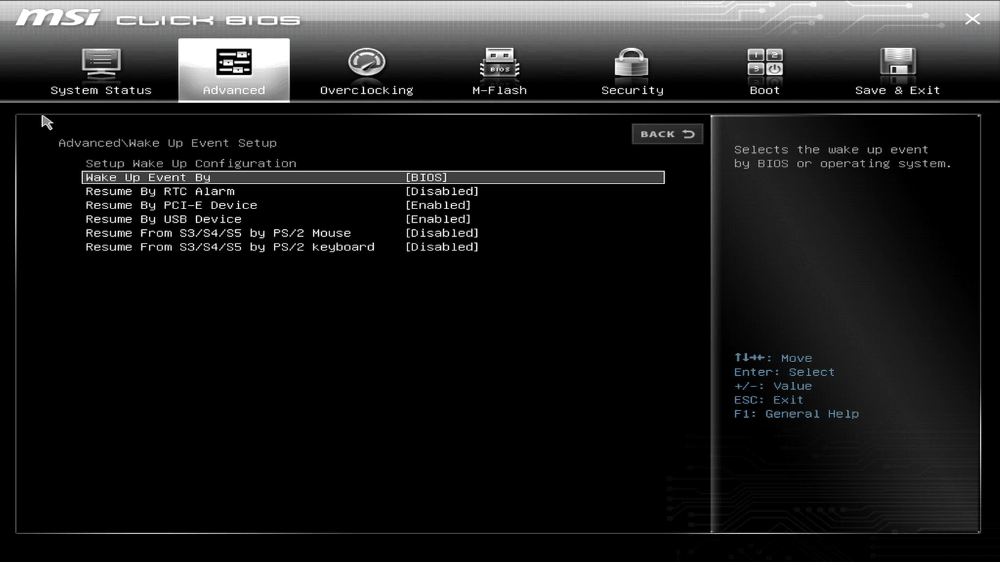

### Overclocking

Nothing here is changed from the defaults except under CPU Features.

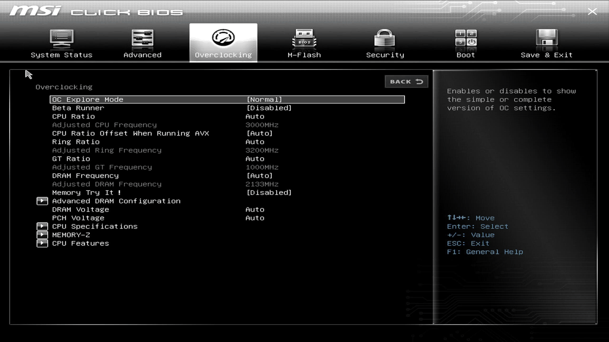

#### CPU Features

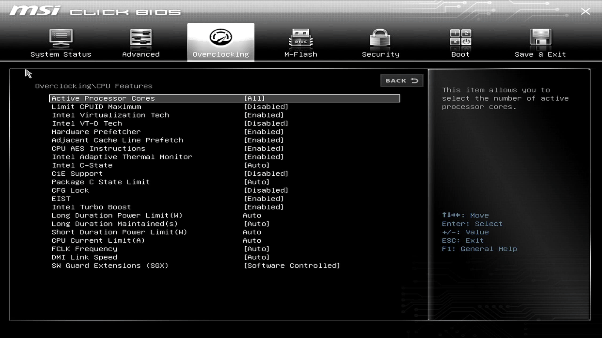

### Boot

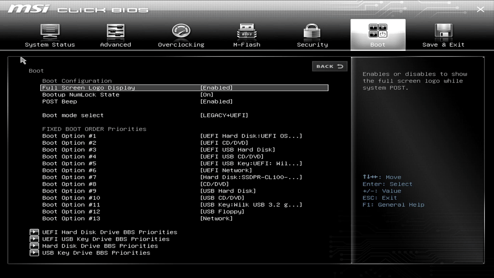

#### UEFI Hard Disk Drive BBS Priorities

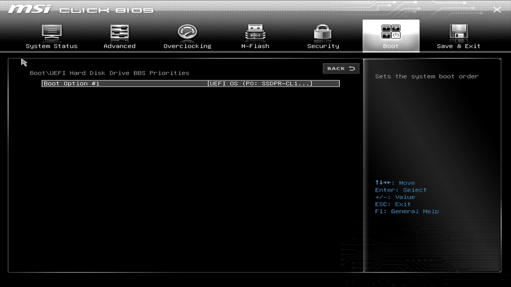

### Save & Exit

To leave without changing anything, use **Discard Changes and Exit**. The *Boot Override* list can also start a single device once, like F11.

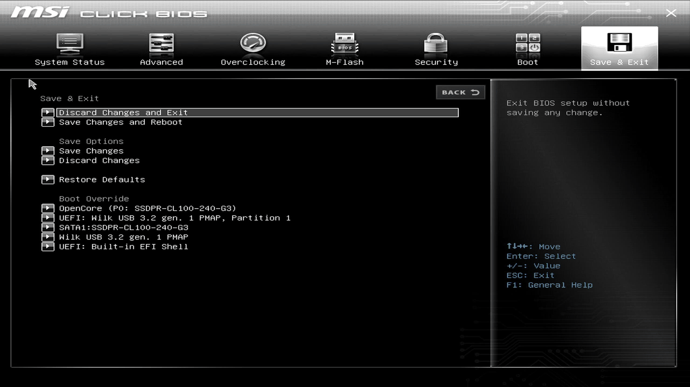
